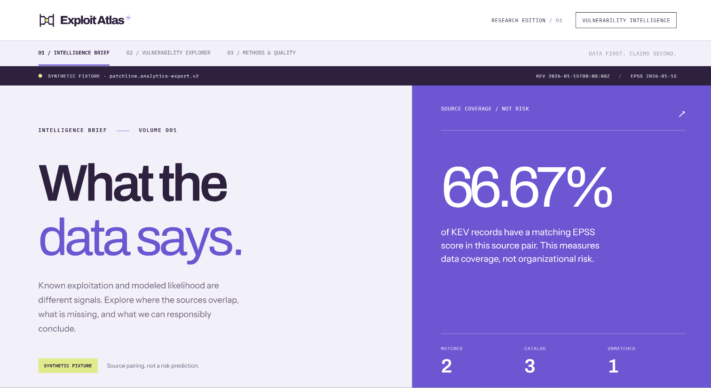
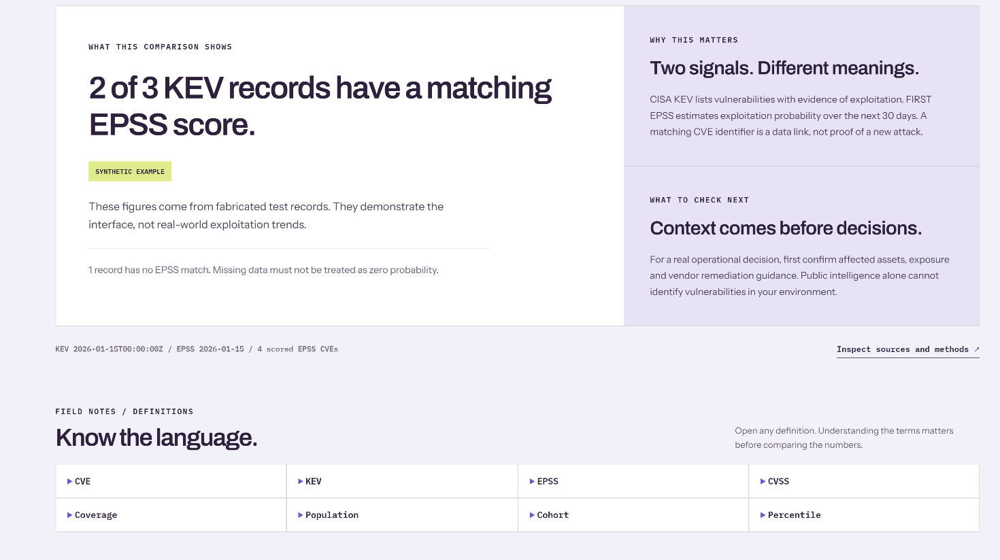

# Exploit Atlas

**Vulnerability Intelligence, Made Clear.**

Exploit Atlas turns archived vulnerability intelligence into **explainable, source-backed analysis**. It connects evidence of known exploitation from CISA KEV with FIRST EPSS probability estimates, then makes the comparisons understandable through an interactive research interface. Behind the interface is a reproducible Python, DuckDB, and dbt pipeline with versioned exports and validation checks.

**[Explore the live demo](https://danielguillaumont.github.io/exploit-atlas/)** · **[Read the real-data case study](docs/research/archived-kev-epss-2026-11.md)** · **[See the product roadmap](docs/roadmap-exploit-atlas.md)**

> **Demo data is synthetic.** The interactive site and screenshots use fabricated, verified test records—not live vulnerability measurements. The [November 2026 research report](docs/research/archived-kev-epss-2026-11.md) is a separate analysis of archived real KEV and EPSS snapshots. Exploit Atlas does not calculate an organization's actual security risk.



*The Intelligence Brief, shown with the verified synthetic v2 fixture.*

## The problem it tackles

**Known exploitation, predicted exploitation, and vulnerability severity are different signals.** KEV identifies vulnerabilities with evidence of exploitation; EPSS estimates the probability of exploitation in the next 30 days; CVSS describes severity, not exploit likelihood. Public intelligence alone cannot determine whether a particular organization is exposed.

Exploit Atlas brings these distinctions into one place, so a reader can trace **what the sources show, which population each percentage describes, what's missing, and what cannot be concluded**.

## Explore the product

| Experience | What it shows |
| --- | --- |
| **01 / Intelligence Brief** | A plain-language finding, data-coverage context, source dates, limitations, and sensible investigation questions. |
| **02 / Vulnerability Explorer** | An analytical view of EPSS score bands and the scored KEV cohort, with source-scoped explanations, selectable intervals, and an explicit unscored category. CVE-level browsing is still a preview, not a populated vulnerability catalog. |
| **03 / Methods & Quality** | Published artifact metadata, source provenance, schemas, counts, recorded digests, and the boundaries of browser-side verification. |



*An interpretation-first view: the summary explains the sample, while the source metadata stays available.*

**Terminology is part of the experience.** Eight expandable definitions explain CVE, KEV, EPSS, CVSS, coverage, population, cohort, and percentile. The EPSS and KEV charts explain their own denominators and update their interpretation with the selected interval.

[View the glossary and distribution](docs/assets/exploit-atlas-glossary.png) · [View the 390px mobile layout](docs/assets/exploit-atlas-mobile.png)

## Engineering behind the interface

| Area | Implemented work |
| --- | --- |
| **Source ingestion & lineage** | Validate archived CISA KEV and FIRST EPSS inputs; preserve source dates, row counts, and content-addressed snapshot identities. |
| **Data engineering** | Python + SQL + DuckDB + dbt staging, full CVE-universe joins, metric reconciliation, and tests. |
| **Analytical marts** | **M03:** KEV-to-EPSS coverage; **M04:** full scored EPSS distribution and quantiles; **M05:** scored KEV cohort distribution with unscored records kept separate. |
| **Consumer contracts** | Verified CSV, JSON, and Parquet bundles with manifest schemas, row counts, SHA-256 digests, and v1/v2 compatibility. |
| **Frontend & quality** | React, TypeScript, Vite, keyboard-accessible exploration, explanatory text derived from the data, frontend unit tests, and Playwright regression suites. |
| **Batch foundations** | Deterministic source-pair planning, durable planned state, anchored journaling, and append-only *proposal* events. These are not a completed execution scheduler or proof that pipeline stages ran. |

```text
Archived KEV + EPSS snapshots
              │
   Python validation and ingestion
              │
        DuckDB warehouse
              │
    dbt staging + CVE joins
              │
    M03 coverage / M04 EPSS / M05 cohort
              │
    Verified, versioned export bundle
    v1: 9 artifacts | v2: 12 artifacts
              │
      Exploit Atlas React interface
```

**Contract note:** v1 is still the default export and contains M03/M04; opt-in v2 adds the M05 cohort mart and comparison view. Both use CSV, JSON, and Parquet. See [export versioning](docs/exports-p51b.md).

## Real-data research, separately published

The [archived November 2026 KEV/EPSS cohort study](docs/research/archived-kev-epss-2026-11.md) is reproducible research based on verified source snapshots—not the sample used by the hosted interface.

Its recorded populations are **1,779 KEV CVEs** and **404,864 scored EPSS CVEs**. In those particular snapshots, **51.10%** of scored KEV CVEs fall into the highest EPSS band (`0.500–1.000`), compared with **1.08%** of the full EPSS population. The scored KEV set is a subset of the EPSS population, so these are overlapping, non-independent groups. These are historical descriptive comparisons, not a forecast or an organizational prioritization rule.

The [report](docs/research/archived-kev-epss-2026-11.md) includes exact source timestamps, snapshot IDs, band counts, methodology, and limitations.

## Run locally

**Prerequisites:** Windows PowerShell 5.1, Python 3.12, [uv](https://docs.astral.sh/uv/), and Node.js 22 or newer. From the repository root:

```powershell
.\scripts\Start-PatchlineDemo.ps1
```

The launcher builds an isolated synthetic DuckDB fixture, runs dbt checks, verifies the v2 export bundle, and serves the populated frontend. Use `-Port 5174` if port 5173 is already in use. Press **Ctrl+C** to stop it. See the [local demo guide](docs/demo-p52b.md).

### Reproduce the fixture and pipeline checks

These commands use a fabricated local fixture; they do not fetch live vulnerability feeds:

```powershell
uv sync --locked --python 3.12
$env:PATCHLINE_DUCKDB_PATH = Join-Path $env:TEMP ("exploit-atlas-fixture-" + [guid]::NewGuid().ToString("N") + ".duckdb")
uv run --locked python -m patchline.fixtures.ci_warehouse create --output $env:PATCHLINE_DUCKDB_PATH
uv run --locked dbt run --project-dir dbt --profiles-dir dbt
uv run --locked dbt test --project-dir dbt --profiles-dir dbt
uv run --locked python -m patchline.fixtures.ci_warehouse verify-m05 --output $env:PATCHLINE_DUCKDB_PATH
uv run --locked pytest
uv run --locked ruff check .
```

To create and verify a fresh v2 export:

```powershell
$out = Join-Path $env:TEMP ("exploit-atlas-v2-" + [guid]::NewGuid().ToString("N"))
uv run --locked python -m patchline.exports.analytics create --contract v2 --database $env:PATCHLINE_DUCKDB_PATH --output $out
uv run --locked python -m patchline.exports.analytics verify --output $out
```

Frontend checks (from the repository root):

```powershell
Push-Location apps/web
npm ci
npm test
npm run build
npx playwright install chromium
npm run test:e2e
npm run test:e2e:v2
Pop-Location
```

## Methods, evidence, and next milestones

**[Architecture](docs/architecture.md)** · **[Methodology](docs/methodology.md)** · **[Export contracts](docs/exports-p51b.md)** · **[EA-02B interpretation](docs/ea02b-chart-interpretation.md)** · **[Product roadmap](docs/roadmap-exploit-atlas.md)**

The next planned data-source milestone is **NVD integration**, followed by validated multi-source joins and richer CVE-level exploration. These are roadmap items, **not implemented features**.

**Current limits:** The public site is a synthetic demonstration, not a live feed, CVE-level inventory, production API, SOC detection system, or organization-specific risk assessor. Recorded artifact digests in the browser are metadata, not claims that the browser has independently downloaded and hashed every artifact.

**Naming compatibility:** The public product is Exploit Atlas. Existing Python imports, CLI calls, schema identifiers, local paths, and the `Start-PatchlineDemo.ps1` launcher retain `patchline` intentionally for backward compatibility.

*Screenshots are cropped captures of the actual local synthetic demo reviewed on November 13, 2026. No data or UI elements were added to the images. [Screenshot provenance](docs/readme-screenshots.md).*
