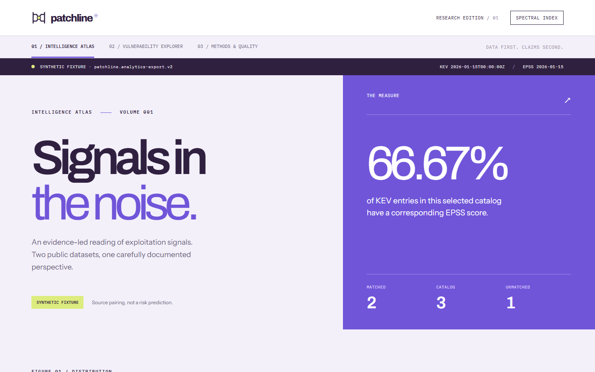
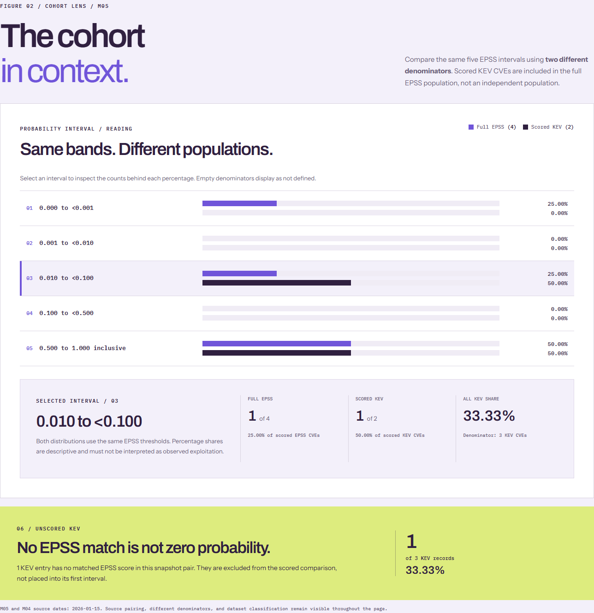

# Patchline

**Evidence-led vulnerability intelligence, built to be reproduced.**

Patchline is a local-first security analytics project that joins archived [CISA Known Exploited Vulnerabilities (KEV)](https://github.com/cisagov/kev-data) catalog snapshots with [FIRST Exploit Prediction Scoring System (EPSS)](https://www.first.org/epss/data) daily scores. It combines a tested data pipeline with **Spectral Index**, a research interface that makes its calculations, source dates, and limits visible.

**Stack:** Python 3.12 · SQL · DuckDB · dbt · React · TypeScript · Vite · Playwright

> **Demo classification:** The screenshots below are generated from a verified **synthetic fixture**. Their dates, CVE counts, and percentages are test data, not current vulnerability measurements. Patchline is not a live feed or an organizational risk-scoring system.



## What the project demonstrates

| Engineering area | What is implemented |
| --- | --- |
| **Ingestion and provenance** | Validated, archived KEV and EPSS inputs; immutable snapshot IDs, source dates, and source record counts |
| **Data modeling** | DuckDB warehouse, dbt staging, a full CVE-universe join, reconciliation tests, and three analytical metric families |
| **Analytics** | M03 KEV score coverage; M04 full EPSS distribution and quantiles; M05 KEV cohort distribution with an explicit unscored category |
| **Data contracts** | Immutable CSV, JSON, and Parquet artifacts with row counts, schemas, SHA-256 digests, and versioned consumer manifests |
| **Application and QA** | Responsive React/TypeScript frontend, keyboard-accessible inspectors, Python and dbt checks, and Playwright browser regression |

## Inside Spectral Index

**01 / Intelligence Atlas.** Inspect KEV coverage and the full EPSS score distribution, including zero-count bands. Each number has a declared denominator.

**02 / Cohort lens.** Compare the same probability intervals for all scored EPSS records and the subset also present in KEV. The subsets overlap, and unscored KEV records remain outside the probability axis.



**03 / Methods & Quality.** Browse the manifest, source snapshots, and recorded metadata for each published artifact. The browser does not claim to cryptographically verify files it has not downloaded.

[View the evidence inspector screenshot](docs/assets/spectral-index-evidence.png) · [View the mobile layout](docs/assets/spectral-index-mobile.png)

The **Vulnerability Explorer** is deliberately a preview. A CVE-level browsing contract has not yet been published; the interface does not invent individual vulnerability records.

## From source to interface

```text
Archived KEV and EPSS snapshots
             |
    Python validation and ingestion
             |
         DuckDB warehouse
             |
   dbt staging + full CVE join
             |
        M03 / M04 / M05
             |
  Versioned, verified export bundle
      v1: 9 artifacts / v2: 12
             |
       Spectral Index UI
```

**Contract compatibility:** v1 remains the default and publishes M03/M04. Opt-in v2 adds the six-row M05 cohort mart and a corresponding comparison view. Both bundles include CSV, JSON, and Parquet artifacts. See [export contract and migration notes](docs/exports-p51b.md).

**Interpretation matters:** EPSS is a model estimate of exploitation probability over the next 30 days. KEV membership indicates known exploitation. Neither by itself measures exposure, business impact, or risk in a specific environment. The scored KEV cohort is part of the full EPSS population, not an independent sample.

## Quick start: verified synthetic demo

On Windows, use PowerShell 5.1 with Node.js 22 or newer, uv, and Python 3.12 available to uv.

Run `.\scripts\Start-PatchlineDemo.ps1` from the repository root.

The launcher creates an isolated synthetic DuckDB warehouse, runs dbt tests, verifies a v2 export, and starts Spectral Index locally.

Open the local URL displayed by the launcher. All measurements are synthetic test data, not live vulnerability statistics.

Press Ctrl+C to stop the demo.

If port 5173 is busy, stop the existing Vite server or run `.\scripts\Start-PatchlineDemo.ps1 -Port 5174`.

For prerequisites and cleanup details, see the [local demo guide](docs/demo-p52b.md).

## Reproduce the pipeline

Requirements: **Python 3.12**, [uv](https://docs.astral.sh/uv/), and a local shell. These PowerShell 5.1 commands create an isolated, invented fixture without downloading live vulnerability feeds:

```powershell
uv sync --locked --python 3.12
$env:PATCHLINE_DUCKDB_PATH = Join-Path $env:TEMP ("patchline-demo-" + [guid]::NewGuid().ToString("N") + ".duckdb")
uv run --locked python -m patchline.fixtures.ci_warehouse create --output $env:PATCHLINE_DUCKDB_PATH
uv run --locked dbt run --project-dir dbt --profiles-dir dbt
uv run --locked dbt test --project-dir dbt --profiles-dir dbt
uv run --locked python -m patchline.fixtures.ci_warehouse verify-m05 --output $env:PATCHLINE_DUCKDB_PATH
uv run --locked pytest
uv run --locked ruff check .
```

To create an independently verified v2 export, from the repository root use a **new** empty output directory:

```powershell
$out = Join-Path $env:TEMP ("patchline-v2-" + [guid]::NewGuid().ToString("N"))
uv run --locked python -m patchline.exports.analytics create --contract v2 --database $env:PATCHLINE_DUCKDB_PATH --output $out
uv run --locked python -m patchline.exports.analytics verify --output $out
```

To view a populated local site, follow the [verified v2 demo setup](docs/frontend-p51c.md). The website starts with an honest unavailable-data state if no approved demo bundle is loaded.

## Frontend and browser tests

Node.js 22 is required. Use a separate frontend terminal:

```powershell
Set-Location apps/web
npm ci
npm test
npm run build
npx playwright install chromium
npm run test:e2e
npm run test:e2e:v2
```

Both browser suites generate independent synthetic fixtures and run an isolated Vite server. For curated, reproducible README screenshots, see [Portfolio screenshot capture](docs/portfolio-proof.md). These are browser captures of the real application, not mockups.

## Methods and project notes

- [Architecture](docs/architecture.md) and [methodology](docs/methodology.md)
- [M03 KEV coverage](docs/dbt-p33-m03.md), [M04 EPSS distribution](docs/dbt-p33-m04.md), [M05 cohort analysis](docs/dbt-p51-m05.md)
- [Export validation](docs/exports-p34-consumers.md) and [v2 versioning](docs/exports-p51b.md)
- [Spectral Index implementation](docs/frontend-p41b3.md) and [cohort comparison](docs/frontend-p51c.md)

**Scope:** Aggregate research analytics with explicit provenance. No live SOC detection, CVE-level explorer, production API, or per-organization risk assessment is claimed.
